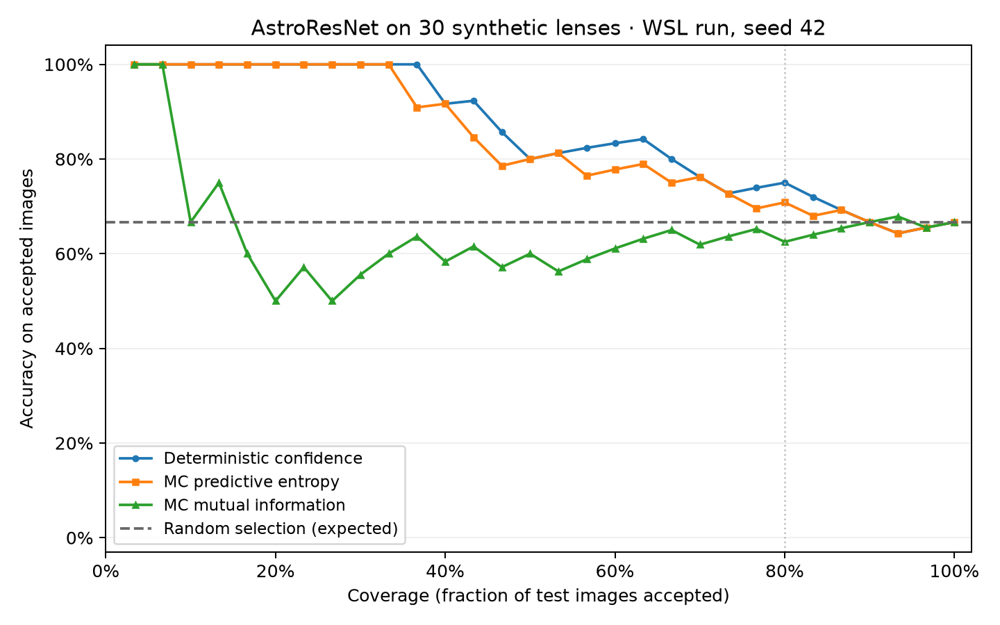

# AstroLens-Uncertainty

Bayesian Uncertainty Quantification, Photometric Physics, and Exact $D_4$ Lattice Symmetries for Strong Gravitational Lensing and Scientific Imaging.

*Status: Active development (MVP in progress).*
## Reproduce the paired CPU baseline

Run these commands from the repository root in a Python 3.11+ environment with
CPU PyTorch installed. Use a fresh data directory to reproduce the reference
sample, since the generator overwrites matching filenames and retains other files.

```bash
python -m pip install -e '.[dev]'
OMP_NUM_THREADS=1 python -m astrolens.data.synthetic_fits --output-dir data/reference42 --samples-per-class 50 --seed 42
python -m astrolens.benchmark --data data/reference42 --output results/reference42 --seed 42 --epochs 10 --batch-size 16
```

The simulator generates 150 independent cutouts across three classes. Both
models see the same 90 training images in the same minibatch order, 30
validation images and 30 test images. Splitting by file assumes one independent
simulation per file. Multiple exposures or augmented copies of one lens would
require splitting by lens identity. Both models use the same arcsinh stretch
(10 ADU scale, zero residual sky), no augmentation, AdamW (learning rate
0.001, weight decay 0.01) and cross-entropy. Each model retains the epoch with
the lowest validation negative log-likelihood (NLL) and is evaluated on the
held-out test set once. Parameter matching does not imply matched compute.

Each run requires a new output directory. It contains the selected weights for
each architecture and a JSON report with the file assignments, SHA-256 digests,
package versions, validation history, test NLL, accuracy, macro-F1 and confusion
matrices (rows are true classes). Repeat runs in the same software environment
to check numerical reproducibility.

### Synthetic reference run

| Architecture | Trainable parameters | Selected epoch | Test accuracy | Macro-F1 | NLL |
| --- | ---: | ---: | ---: | ---: | ---: |
| AstroResNet | 174,515 | 10 | 22/30 | 0.683 | 0.536 |
| LensViT | 175,619 | 7 | 19/30 | 0.524 | 0.595 |

Both models recovered all ten simulated anomalies. AstroResNet classified eight
of ten subhalo images as smooth. LensViT classified all ten smooth images as
subhalos. These are single-seed results on this generator, with only ten test
images per class. They establish a reproducible baseline for studying class
confusion. Performance on observed lenses and out-of-distribution anomalies
remains unmeasured. See the [reference report](docs/benchmarks/reference42.json).

### Can AstroResNet identify its own errors?

We ranked 30 held-out synthetic lenses for review using deterministic confidence,
MC predictive entropy and estimated mutual information. The predicted class
was held fixed across all three rankings. MC Dropout used 20 passes.

This figure uses the seed-42 WSL checkpoint selected at epoch 9. It classified
20/30 images correctly. The reference run above selected epoch 10 and reached
22/30 on the same test images.



| Review criterion | Errors found in 6 reviews | Correct among 24 accepted |
| --- | ---: | ---: |
| Lowest deterministic confidence | 4/10 | 18/24 (75.0%) |
| Highest MC predictive entropy | 3/10 | 17/24 (70.8%) |
| Highest estimated mutual information | 1/10 | 15/24 (62.5%) |

At 80% coverage, deterministic confidence found one more error than predictive
entropy. All ten errors in this run were `smooth` lenses classified as
`cdm_subhalo`, so the result is sensitive to which classes each criterion
sends for review. The ranking also changes with coverage.

To redraw the figure from the published per-image predictions, run:

```bash
MPLBACKEND=Agg python scripts/plot_selective_accuracy.py \
  --csv docs/benchmarks/resnet_mc20_seed42_test.csv \
  --output selective_accuracy.png
```
