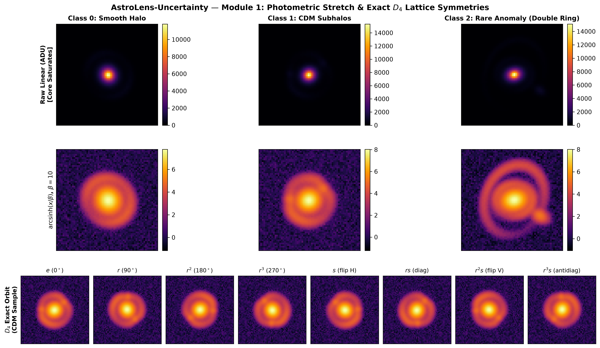

# AstroLens Uncertainty

[](https://github.com/hugo-martinez-hme/astrolens-uncertainty/actions/workflows/ci.yml)
[](LICENSE)

A scientific machine learning benchmark for synthetic strong gravitational lens
classification, predictive uncertainty, and prioritization of images for human review.
It compares a compact convolutional network and a vision transformer under a shared
CPU training and evaluation protocol.

## Key finding

On a held-out set of 30 synthetic images, reviewing the six lowest-confidence
LensViT predictions identified **5 of its 11 classification errors**. Accuracy on
accepted predictions increased from 19/30 (63.3%) to 18/24 (75.0%) at 80% coverage.
The selection uses model confidence, not the true labels; labels are used only to
measure its performance retrospectively.

Monte Carlo (MC) Dropout did not consistently outperform deterministic confidence
as a review criterion. These are results from one synthetic split, not evidence
of generalization to real survey images or previously unseen anomalies.


## Dataset and models

The simplified morphology generator creates 64 × 64 FITS cutouts with three
balanced classes: `smooth` (smooth ring or arc), `cdm_subhalo` (localized ring
perturbations and brightness knots), and `anomaly` (double-ring morphology with
an asymmetric companion). It includes a Euclid VIS-inspired instrumental model:
Gaussian PSF, Poisson shot noise, Gaussian read noise, sky subtraction and ADU
conversion. FITS headers contain WCS and simulation metadata. This is a
parametrized image generator, not a physical ray-tracing lens solver.

The preprocessing pipeline includes native-endian float32 conversion, finite-value
validation and an arcsinh stretch. Exact rotations and reflections from the square
symmetry group D4 are implemented but not used for augmentation in Benchmark A.



| Model | Architecture | Trainable parameters |
| --- | --- | ---: |
| AstroResNet | Compact residual CNN with spatial dropout | 174,515 |
| LensViT | Vision transformer with explicit multi-head self-attention | 175,619 |

## Experimental protocol (Benchmark A)

The reference dataset consists of 150 synthetic images (50 per class). A stratified
seed-42 split assigns 90 to training, 30 to validation and 30 to testing. Both
models use the same split, minibatch order, arcsinh scale (10 ADU), no augmentation,
AdamW (learning rate 0.001, weight decay 0.01) and cross-entropy. The checkpoint is
selected by the lowest validation negative log-likelihood (NLL) over 10 epochs.
The test set is not used for checkpoint selection. Parameter matching does not imply
matched compute. Splitting by file assumes one independently simulated image per
file; related views of the same lens would require grouping by lens identity.

### Classification results

| Run | Model | Selected epoch | Test accuracy | Macro-F1 | NLL |
| --- | --- | ---: | ---: | ---: | ---: |
| Reference | AstroResNet | 10 | 22/30 | 0.683 | 0.536 |
| Reference | LensViT | 7 | 19/30 | 0.524 | 0.595 |
| WSL | AstroResNet | 9 | 20/30 | 0.556 | 0.563 |
| WSL | LensViT | 7 | 19/30 | 0.524 | 0.595 |

For the WSL checkpoints, AstroResNet reached 20/30 (epoch 9) and LensViT
19/30 (epoch 7). See the [reference report](docs/benchmarks/reference42.json) and
[WSL run report](docs/benchmarks/wsl42.json) for the full metrics, validation
histories, environment versions and FITS hashes. The WSL checkpoints were used
for the uncertainty experiment. The test manifests match, but AstroResNet's
selected checkpoint and confusion matrix differ between runs. The cause of the
difference has not been established.

Both WSL models misclassified all ten `smooth` images as `cdm_subhalo`; LensViT
also misclassified one subhalo as `anomaly`. In the reference run, AstroResNet
instead classified eight of ten subhalos as smooth. Both reference models and
both WSL models correctly classified the ten examples of the known `anomaly`
class.

### Predictive uncertainty and selective prediction

MC Dropout samples 20 stochastic probability vectors per image (seed 42) while
keeping normalization layers in evaluation mode. The analysis uses predictive
entropy of the mean probability vector, mean per-pass entropy, and their
difference (estimated mutual information). Mutual information is a proxy for
model disagreement under MC Dropout, not an exact Bayesian posterior quantity.

Deterministic class predictions are held fixed. Images are ranked for review by
lowest deterministic confidence, highest MC predictive entropy, or highest MC
mutual information. The six highest-priority images are withheld; accuracy is
computed on the 24 accepted images.

| Review criterion | AstroResNet errors found | AstroResNet accepted correct | LensViT errors found | LensViT accepted correct |
| --- | ---: | ---: | ---: | ---: |
| Lowest deterministic confidence | 4/10 | 18/24 | 5/11 | 18/24 |
| Highest MC predictive entropy | 3/10 | 17/24 | 5/11 | 18/24 |
| Highest estimated mutual information | 1/10 | 15/24 | 5/11 | 18/24 |

At 80% coverage, deterministic confidence matched the best observed result for
both architectures. LensViT confidence and mutual information shared four of
their six selections; all three criteria ranked the extra subhalo error 21st
for review. Equal aggregate accuracy does not imply identical review queues.

## Installation and reproducibility

Use Python 3.11 or newer in a virtual environment. The CI workflow tests Python
3.11 with CPU PyTorch. From the repository root:

```bash
python -m venv .venv
source .venv/bin/activate
python -m pip install torch --index-url https://download.pytorch.org/whl/cpu
python -m pip install -e '.[dev]'
```

### 1. Verify and plot published results (no training required)

```bash
python -m pytest tests/test_published_predictions.py -q
MPLBACKEND=Agg python scripts/plot_selective_accuracy.py \
  --csv docs/benchmarks/resnet_mc20_seed42_test.csv \
  --vit-csv docs/benchmarks/lens_vit_mc20_seed42_test.csv \
  --output paired_selective_accuracy.png
```

The [AstroResNet CSV](docs/benchmarks/resnet_mc20_seed42_test.csv) and
[LensViT CSV](docs/benchmarks/lens_vit_mc20_seed42_test.csv) contain per-image
labels, predictions, probabilities and entropy estimates. They support auditing
the published rankings independently of the model weights.

### 2. Run the paired CPU benchmark

Use fresh data and output directories. The generator overwrites matching names
but retains other files; the benchmark requires a new output directory.

```bash
OMP_NUM_THREADS=1 python -m astrolens.data.synthetic_fits \
  --output-dir data/reference42 --samples-per-class 50 --seed 42
python -m astrolens.benchmark \
  --data data/reference42 --output results/reference42 \
  --seed 42 --epochs 10 --batch-size 16
```

The run writes both selected weights and a JSON report. Reproduce in the recorded
software environment and compare FITS hashes, validation histories and test
metrics. The seed and deterministic PyTorch operations do not guarantee identical
results across software versions or hardware.

### 3. Evaluate saved checkpoints with MC Dropout

For a compatible seed-42 run whose test manifest matches the committed reference:

```bash
for model in resnet lens_vit; do
  python scripts/evaluate_mc_dropout.py --model "$model" \
    --run-dir results/reference42 --data-dir data/reference42
done
```

The evaluator checks test paths, FITS hashes and deterministic confusion matrices
against the reports before writing per-image predictions. It may reject a newly
generated dataset if the FITS bytes differ. New run predictions are not necessarily
identical to the published WSL CSVs. The original weights and FITS files are not
tracked in Git; exact checkpoint-level reproduction requires those artifacts.

### 4. Run quality checks

```bash
ruff check .
ruff format --check .
python -m pytest --cov=src/astrolens --cov-report=term-missing
```

## Repository structure

```text
src/astrolens/data/         FITS simulation, dataset and transforms
src/astrolens/models/       CNN, transformer and shared model interface
src/astrolens/uncertainty/  MC Dropout and entropy decomposition
src/astrolens/benchmark.py  Paired training and evaluation
scripts/                   Inspection, checkpoint evaluation and plotting
tests/                    Unit and published-result regression tests
docs/benchmarks/          Reports and per-image predictions
docs/figures/             Experimental figures
```

## Scientific limitations and next steps

- Small, balanced synthetic dataset with one split and one checkpoint per model
  for the uncertainty study. Ten shared errors come from one class.
- The known `anomaly` class is included in training; its classification is not
  out-of-distribution anomaly detection. No real survey validation is reported.
- Review performance measures retrospective ranking of errors, not an operational
  human-in-the-loop system or calibrated error probabilities.
- MC Dropout estimates depend on the trained model and sampling procedure; full
  uncertainty calibration and stability across seeds remain unmeasured.
- Next steps: probability calibration, repeated experiments across seeds, and
  robustness to changes in the synthetic imaging conditions.

## Author and license

Developed by [Hugo Martínez Estévez](https://github.com/hugo-martinez-hme)
as an independent scientific machine learning project.

Released under the [MIT License](LICENSE).
